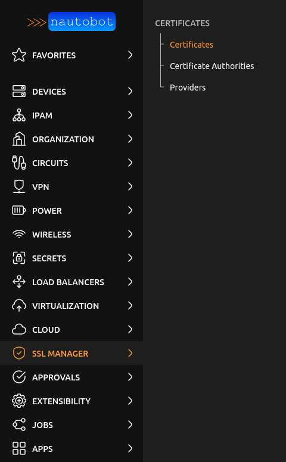
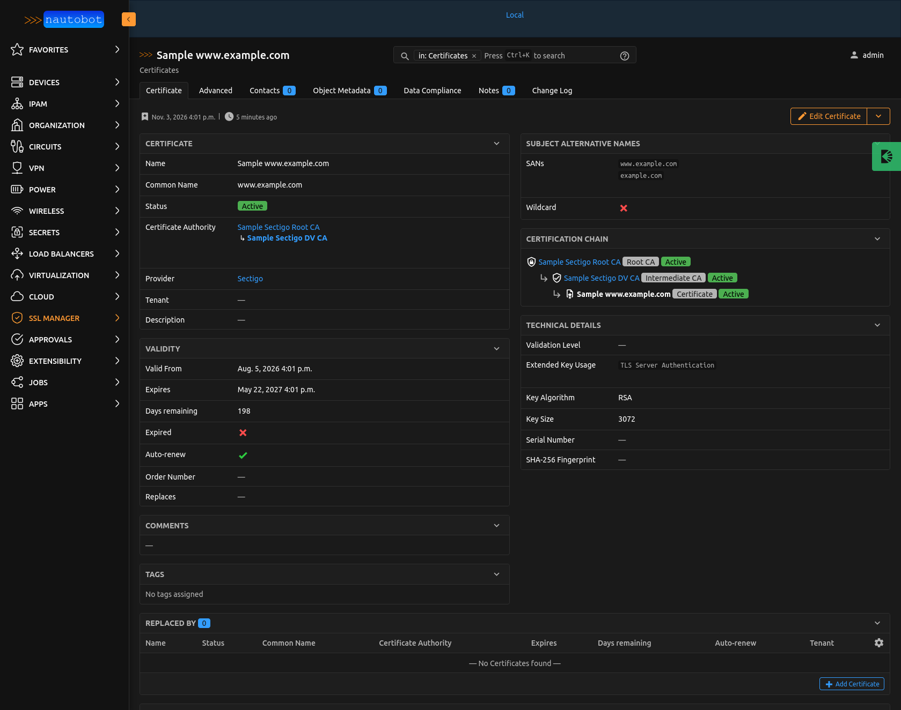

# App Overview

This document provides an overview of the App including critical information and important considerations when applying it to your Nautobot environment.

!!! note
    Throughout this documentation, the terms "app" and "plugin" will be used interchangeably.

## Description

Nautobot SSL Manager adds an inventory of SSL/TLS certificates to Nautobot. It provides three data models:

- [Certificate Provider](../models/certificateprovider.md): the vendor or service through which certificates are obtained (a commercial vendor, Let's Encrypt, an internal PKI team...).
- [Certificate Authority](../models/certificateauthority.md): the CA issuing certificates, organized as a tree of Root and Intermediate CAs.
- [Certificate](../models/certificate.md): an SSL/TLS certificate (public part only), with its identity (CN, SANs, serial number, fingerprint), its validity, its technical characteristics, its issuing CA and its renewal history.

The app adds an **SSL Manager** tab to the navigation menu:

Detail view of a certificate, with its validity, its technical details and its certification chain:

The app follows a "nothing is guessed" principle: data is either entered by the user or read from the certificate itself, never inferred (for example, `auto_renew` stays unknown until set, and the import from PEM never selects the certificate to replace on its own).

!!! warning
    Only public certificates are stored. A PEM containing a private key is rejected, both from the UI and from the REST API.

## Audience (User Personas) - Who should use this App?

- Teams operating services exposed over TLS, who need to know which certificates exist, where they come from and when they expire.
- Teams managing an internal PKI or the relationship with certificate vendors, who need an inventory of CAs and providers.
- Automation and monitoring tooling, which can consume the inventory (including expiration data) through the REST API and GraphQL.

## Authors and Maintainers

- [HyazOulephant](https://github.com/HyazOulephant)

## Nautobot Features Used

- **Navigation**: a dedicated **SSL Manager** menu tab with *Certificates* (including an *Import from PEM* button), *Certificate Authorities* and *Providers*.
- **Data models** with the standard Nautobot features: list, detail, create/edit, bulk edit, bulk delete, CSV import/export, change logging, tags, notes, contacts/teams, custom fields, relationships, global search.
- **Tenancy**: each model can be assigned to a Tenant.
- **Tree model**: Certificate Authorities use Nautobot's tree support (`parent`), with a tree list view.
- **REST API** and **GraphQL** for all models.
- **Custom links, custom validators, export templates and webhooks** can be defined on all models.

### Extras

- **Statuses**: the migrations associate default statuses with the app models. Existing statuses with the same name are reused; missing ones are created.
    - Certificate Authority: `Active`, `Deprecated`, `Retired`.
    - Certificate: `Planned`, `Active`, `Revoked`, `Retired`.
- **Custom Fields**: none created by the app.
- **Jobs**: none provided by the app.
